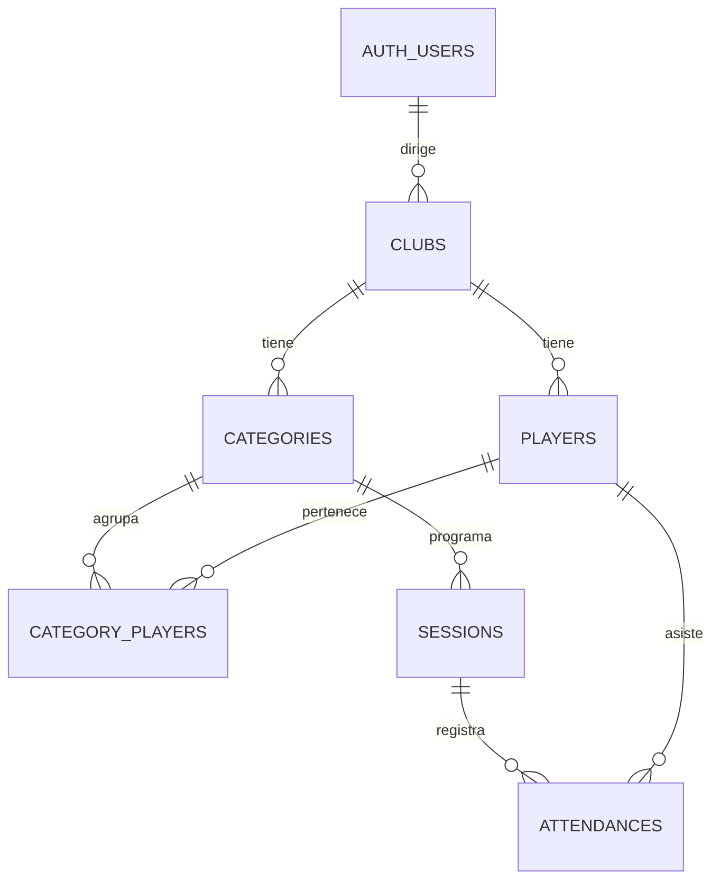
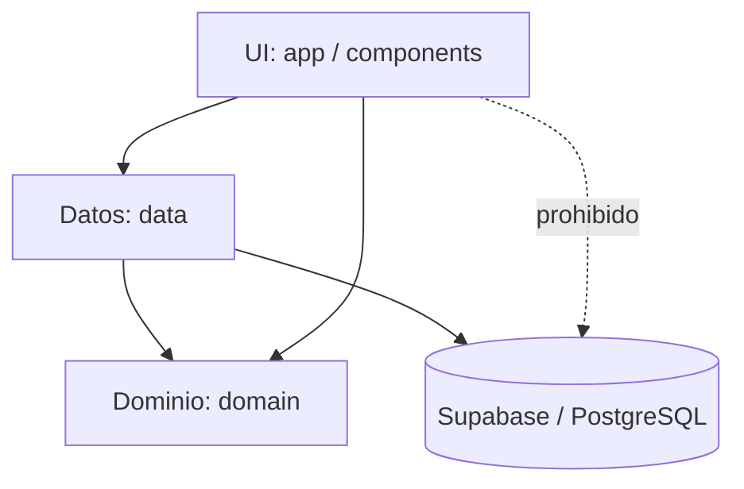

# PRD — Plataforma de asistencia para entrenadores de básquet

---

## 1. Descripción general del producto

### 1.1 Planteamiento del problema

| Problema                                                                         | Impacto operativo                                                                                                      | Línea base actual                    |
| -------------------------------------------------------------------------------- | ---------------------------------------------------------------------------------------------------------------------- | ------------------------------------ |
| La asistencia se lleva en Excel: una hoja por categoría y una columna por clase. | Cargar la clase implica abrir la planilla, buscar la hoja y la columna correcta; es incómodo de hacer desde la cancha. | 100% manual en Excel.                |
| Los recuentos mensuales y anuales se arman a mano con fórmulas.                  | Cada hoja nueva o mes nuevo requiere copiar y ajustar fórmulas; un error de rango falsea los números.                  | Fórmulas mantenidas a mano por hoja. |
| El ranking de asistencia se calcula a mano.                                      | Hay que reordenar y recalcular porcentajes cada vez que se quiere consultar.                                           | Manual, sin cálculo automático.      |
| No hay datos de altas ni abandonos en el tiempo.                                 | No se puede responder "¿cuántos chicos nuevos entraron este año?" o "¿cuántos dejaron?" sin revisar hoja por hoja.     | No medido.                           |
| Entrenadores con varios clubes/escuelitas tienen la información dispersa.        | No hay una vista consolidada por club.                                                                                 | Un archivo (o más) por club.         |

**Síntesis:** el entrenador ya sabe qué quiere medir (lo hacía en Excel), pero el costo de
mantener la planilla es alto y las métricas de evolución del plantel (nuevos, abandonos) no
salen solas. El producto reemplaza la planilla con una carga rápida de asistencia y
estadísticas calculadas automáticamente.

### 1.2 Visión del producto

Una aplicación web, usable desde el celular en la cancha, donde un entrenador organiza sus
clubes y categorías, toma asistencia clase por clase y obtiene, sin fórmulas, las estadísticas
que antes armaba en Excel.

Es **ambas cosas**: un proyecto de aprendizaje (PostgreSQL y desarrollo frontend son objetivos
explícitos) y una herramienta pensada para ser útil a cualquier entrenador. Por eso el
documento prioriza que el modelo de datos y las estadísticas vivan en PostgreSQL (vistas SQL,
constraints, Row Level Security) en lugar de resolverse todo en el frontend.

Pilares:

1. **Carga rápida:** tomar asistencia de una clase en menos de un minuto desde el celular.
2. **Estadísticas sin fórmulas:** todo lo que el Excel calculaba, calculado por la base.
3. **Multi-club:** un entrenador con N clubes y N categorías por club.

### 1.3 Metas y no metas

**En el alcance (v1.0):**

- Registro e inicio de sesión del entrenador.
- ABM de clubes, categorías (por temporada) y jugadores.
- Alta y baja (abandono) de jugadores con fecha.
- Inicio de temporada: crear las categorías del año nuevo y pasar a cada jugador a su
  categoría.
- Trayectoria de cada jugador en el club (categorías por temporada y % de asistencia).
- Carga de clases por fecha y toma de asistencia por clase.
- Vista mensual por categoría (jugadores × clases), equivalente a la hoja de Excel.
- Estadísticas: jugadores por categoría mes a mes, total por club, % de nuevos (por categoría
  y total del club), abandonos, clases por mes y por año, ranking de asistencia con %.

**Fuera de alcance (v1.0):**

- Compartir clubes/categorías entre varios entrenadores (ver D-04).
- Importar planillas de Excel existentes (ver D-14).
- Exportar a Excel/PDF (ver D-14).
- Clases recurrentes / calendario automático de clases (ver D-08).
- Estado "ausente justificado" (ver D-09).
- Modo offline (ver D-15).
- App nativa móvil (se cubre con web responsive).
- Datos de jugadores más allá de nombre, año de nacimiento y fechas (contacto, tutor, fecha
  de nacimiento completa).
- Asignación automática de categoría por año de nacimiento (ver D-25).

### 1.4 Métricas de éxito

| Métrica                                                 | Definición                                                                                            | Objetivo                                                       |
| ------------------------------------------------------- | ----------------------------------------------------------------------------------------------------- | -------------------------------------------------------------- |
| **North Star:** clases con asistencia tomada por semana | Cantidad de clases con al menos un presente registradas en la semana, sumando todos los entrenadores. | ≥ 4 por entrenador activo (equivalente al uso real del autor). |
| Tiempo de carga de una clase                            | Desde abrir la clase hasta guardar, con 20 jugadores.                                                 | < 60 s en celular.                                             |
| Paridad con el Excel                                    | Estadísticas del Excel original reproducidas por la app.                                              | 6 de 6 (las de `CLAUDE.md`).                                   |
| Uso propio                                              | El autor deja de usar el Excel para sus categorías.                                                   | 1 temporada completa sólo con la app.                          |

---

## 2. Contexto del dominio

Básquet formativo y juvenil: un club tiene varias **categorías** (por ejemplo, por edad). Un
entrenador puede trabajar en varios clubes y escuelitas de minibásquet. Cada categoría entrena
varias veces por semana; cada entrenamiento es una **clase**. La asistencia por clase es la
unidad de dato; todo lo demás (recuentos, porcentajes, rankings) se deriva.

**Temporadas.** La temporada coincide con el año calendario. Las categorías se arman por año
de nacimiento y los años que abarca cada una cambian de una temporada a otra (ejemplo real:
U13 fue "2009", al año siguiente "2010/2011" y después "2011/2012"). Por eso cada año el
plantel de una categoría cambia casi entero y los jugadores pasan de categoría. En el Excel se
empezaba un archivo nuevo por año. En la app, cada categoría pertenece a una temporada
("U13 2026" y "U13 2027" son categorías distintas). El jugador es la misma persona en todas
las temporadas y su paso por cada categoría queda registrado como una **pertenencia**.

### 2.1 Definiciones de cálculo

Estas definiciones son la base de todas las estadísticas y se usan igual en todo el sistema.

| Concepto                                         | Definición                                                                                                                                                                                                                                                      |
| ------------------------------------------------ | --------------------------------------------------------------------------------------------------------------------------------------------------------------------------------------------------------------------------------------------------------------- |
| Mes                                              | Mes calendario (1 al último día).                                                                                                                                                                                                                               |
| Año / temporada                                  | Año calendario (1/1 al 31/12). Cada categoría pertenece a una sola temporada.                                                                                                                                                                                   |
| **Pertenencia**                                  | Período en que un jugador estuvo en una categoría: `fecha_alta` y `fecha_baja` (nula si no se dio de baja). Su fin efectivo es `fecha_baja` o el 31/12 de la temporada de la categoría.                                                                         |
| Jugador **activo** en la categoría C en el mes M | Tiene una pertenencia en C con `fecha_alta ≤ último día de M` y fin efectivo `≥ primer día de M`.                                                                                                                                                               |
| Jugador **activo** en el club en el mes M        | Activo en al menos una categoría del club en M. Se cuenta **una vez** aunque esté en dos categorías.                                                                                                                                                            |
| Jugador **nuevo** en el mes M                    | La `fecha_alta` de su **primera pertenencia en el club** (en cualquier categoría y temporada) cae dentro de M. Pasar de categoría o volver después de una baja **no** lo hace nuevo. En una categoría, es nuevo si esa primera pertenencia es en esa categoría. |
| **% de nuevos** en M                             | nuevos en M ÷ activos en M × 100.                                                                                                                                                                                                                               |
| **Abandono** en el mes M                         | Una pertenencia con `fecha_baja` dentro de M. La baja la marca el entrenador. Terminar la temporada sin pasar a otra categoría **no** es abandono.                                                                                                              |
| **Clases** del período                           | Clases cargadas con fecha dentro del período.                                                                                                                                                                                                                   |
| **% de asistencia** de un jugador en un período  | presentes ÷ clases del período en las que el jugador estaba activo (fecha dentro de alguna de sus pertenencias en esa categoría) × 100. Si el divisor es 0, no se muestra porcentaje.                                                                           |

---

## 3. Perfiles de usuario

| Perfil                | Rol y contexto                                                                       | Objetivo principal                                          | Problema actual                                        |
| --------------------- | ------------------------------------------------------------------------------------ | ----------------------------------------------------------- | ------------------------------------------------------ |
| Entrenador de un club | Dirige 1 club con varias categorías (caso del autor: 4 categorías).                  | Tomar asistencia rápido y tener ranking y recuentos al día. | Mantener una hoja de Excel por categoría con fórmulas. |
| Entrenador multi-club | Dirige varios clubes y/o escuelitas de minibásquet, con 1 o más categorías cada uno. | Ver cada club por separado sin mezclar planteles.           | Información dispersa en varios archivos.               |

Hay **un solo rol** en el sistema: el entrenador. Cada entrenador ve sólo sus datos.

**Perfil ampliado (usuario principal).** El autor entrena básquet formativo y juvenil en un
club con 4 categorías. En cada clase sabe quién vino; después pasaba esa información a una
hoja de Excel por categoría, con una columna por clase, y mantenía recuentos mensuales,
anuales y un ranking de asistencia. Quiere hacer lo mismo desde el celular, al terminar o
durante la clase, sin mantener fórmulas.

---

## 4. Arquitectura de datos

### 4.1 Entidades principales

| Entidad                 | Campos principales                                                                                       | Notas                                                   |
| ----------------------- | -------------------------------------------------------------------------------------------------------- | ------------------------------------------------------- |
| `auth.users` (Supabase) | `id`, `email`                                                                                            | El entrenador. No se crea tabla de perfil propia en v1. |
| `clubs`                 | `id`, `coach_id → auth.users`, `name`, `created_at`                                                      |                                                         |
| `categories`            | `id`, `club_id → clubs`, `name`, `season_year` (smallint), `created_at`                                  | Una categoría de **una** temporada ("U13 2026").        |
| `players`               | `id`, `club_id → clubs`, `first_name`, `last_name`, `birth_year` (smallint, nullable), `created_at`      | La **persona**. Es la misma en todas las temporadas.    |
| `category_players`      | `id`, `category_id → categories`, `player_id → players`, `joined_on`, `left_on` (nullable), `created_at` | **Pertenencia**: `joined_on` = alta, `left_on` = baja.  |
| `sessions`              | `id`, `category_id → categories`, `held_on` (date), `created_at`                                         | Una clase.                                              |
| `attendances`           | `session_id → sessions`, `player_id → players`, PK compuesta                                             | Existe una fila sólo si el jugador estuvo **presente**. |

Relaciones:



Ejemplo: Juan entra al club en marzo de 2025 a U13. En 2026 pasa a U15. Deja en mayo de 2026 y
vuelve en septiembre.

| player | category | joined_on  | left_on    | Qué cuenta                                   |
| ------ | -------- | ---------- | ---------- | -------------------------------------------- |
| Juan   | U13 2025 | 2025-03-03 | —          | Nuevo en marzo 2025 (primera vez en el club) |
| Juan   | U15 2026 | 2026-03-02 | 2026-05-15 | No es nuevo; abandono en mayo 2026           |
| Juan   | U15 2026 | 2026-09-07 | —          | No es nuevo (ya tenía historial)             |

### 4.2 Reglas de integridad

- `clubs`: `unique(coach_id, name)`; `name` no vacío.
- `categories`: `unique(club_id, name, season_year)`; borrado en cascada desde `clubs`.
- `players`: `birth_year` entre 1900 y el año actual (si existe); borrado en cascada desde
  `clubs`.
- `category_players`: `check (left_on is null or left_on >= joined_on)`; `joined_on` y
  `left_on` dentro del `season_year` de la categoría (trigger); dos pertenencias del mismo
  jugador en la misma categoría **no se superponen** (restricción de exclusión
  `exclude using gist (category_id with =, player_id with =, daterange(joined_on, left_on, '[]') with &&)`,
  requiere la extensión `btree_gist`); el jugador y la categoría son del mismo club; borrado
  en cascada desde `categories` y `players`.
- `sessions`: `unique(category_id, held_on)`; `held_on` dentro del `season_year` de la
  categoría; borrado en cascada desde `categories`.
- `attendances`: PK `(session_id, player_id)`; borrado en cascada desde `sessions` y `players`.
- Trigger `attendances_validate`: el jugador debe tener una **pertenencia en la categoría de
  la clase** que incluya la fecha de la clase.
- Row Level Security en todas las tablas: un entrenador sólo lee/escribe filas cuyo club tiene
  `coach_id = auth.uid()`. Se implementa con las funciones SQL `owns_club(club_id)` y
  `owns_category(category_id)`.

### 4.3 Vistas (agregados)

Todas se crean en el Hito 4 (US-401). Ninguna existe todavía.

| Vista                    | Granularidad              | Contenido                                                                                   |
| ------------------------ | ------------------------- | ------------------------------------------------------------------------------------------- |
| `category_monthly_stats` | categoría × mes           | activos, nuevos, % nuevos, abandonos, clases.                                               |
| `club_monthly_stats`     | club × mes                | lo mismo por club, contando **personas distintas**.                                         |
| `player_attendance`      | jugador × clase aplicable | 1/0 presente, para calcular % en cualquier período.                                         |
| `player_seasons`         | jugador × categoría       | temporada, categoría, alta, baja, presentes, clases aplicables, %. Alimenta la trayectoria. |

Las vistas se crean con `security_invoker = true` para que respeten RLS.

---

## 5. Arquitectura de software

### 5.1 Stack

Next.js (App Router) + TypeScript + Tailwind CSS en Vercel; Supabase (PostgreSQL + Auth) usando `@supabase/ssr`. **Por qué:** es el stack ya considerado en `CLAUDE.md`; Next.js es el framework con despliegue nativo en Vercel; TypeScript ayuda a aprender con errores tempranos; Tailwind evita mantener CSS a mano.

### 5.2 Capas

| Capa          | Ubicación                     | Responsabilidad                                                                                           |
| ------------- | ----------------------------- | --------------------------------------------------------------------------------------------------------- |
| Base de datos | `supabase/migrations/`        | Tablas, constraints, triggers, RLS, vistas de estadísticas.                                               |
| Dominio       | `src/domain/`                 | Tipos y funciones puras (validaciones, cálculos de fechas de mes). Sin dependencias de Supabase ni React. |
| Datos         | `src/data/`                   | Consultas a Supabase (una función por operación) y Server Actions.                                        |
| UI            | `src/app/`, `src/components/` | Páginas, formularios, componentes. Sólo llama a `src/data/`.                                              |



Regla: la UI nunca llama a Supabase directo; el dominio no importa nada de las otras capas.

### 5.3 Patrones

- **Server Components** para lectura y **Server Actions** para escritura (sin API REST propia).
- **Repository simple:** un archivo por entidad en `src/data/` (`clubs.ts`, `players.ts`, …).
- **Cálculo en la base:** las estadísticas se resuelven en vistas SQL, no en TypeScript.

### 5.4 Qué va en cada capa (guía práctica)

- ¿Es una regla que la base puede garantizar (unicidad, fechas válidas)? → migración SQL.
- ¿Es una validación de formulario o un cálculo con fechas sin acceso a datos? → `src/domain/`.
- ¿Lee o escribe en Supabase? → `src/data/`.
- ¿Se ve en pantalla? → `src/app/` o `src/components/`.

---

## 6. Acuerdo de ingeniería y estándares

- **Principios:** dos desarrolladores; ramas cortas por historia de usuario con PR a `main`
  (autorrevisión + CI verde para mergear); migraciones SQL versionadas, nunca cambios a mano en
  la base de producción.
- **Pruebas:** Vitest para dominio (unitarias); Vitest contra Supabase local para RLS, triggers y
  vistas (integración); Playwright sólo para el flujo principal (Hito 5). Sin cobertura mínima
  obligatoria; toda regla de la sección 7 tiene al menos un test.
- **Esfuerzo:** S (1-2 días) · M (3-5 días) · L (6-10 días) · XL (>10, partir).
- **Prioridad:** Urgente (bloqueante) · Alta · Media · Baja.
- **Gestión:** el orden de trabajo es el de la sección 10; dentro de un hito, por dependencias.

---

## 7. Reglas de negocio consolidadas

- **RN-01** Cada entrenador ve y modifica sólo sus clubes y todo lo que cuelga de ellos.
- **RN-02** Un jugador es una persona del club. En cada temporada puede tener una o más
  pertenencias a categorías de esa temporada (D-10, D-24).
- **RN-03** Un jugador puede tener asistencia sólo en clases de una categoría donde tiene una
  pertenencia que incluye la fecha de la clase.
- **RN-04** Dar de baja un jugador no borra su historial; sigue contando en los meses en que
  estuvo activo.
- **RN-05** Un jugador (o una pertenencia) con asistencias registradas no se puede eliminar,
  sólo dar de baja. Sin asistencias sí se puede eliminar (para corregir errores de carga).
- **RN-06** No puede haber dos clases de la misma categoría en la misma fecha (D-11).
- **RN-07** Eliminar un club o una categoría elimina todo su contenido, previa confirmación
  escribiendo el nombre.
- **RN-08** Todas las estadísticas usan las definiciones de la sección 2.1.
- **RN-09** Un jugador es "nuevo" sólo la primera vez que entra al club. Pasar de categoría o
  volver después de una baja no lo hace nuevo (D-05, D-21).
- **RN-10** La baja (abandono) la marca el entrenador con fecha. El fin de temporada no es una
  baja (D-06).

---

## 8. Requisitos No Funcionales

| Categoría      | Requisito                                                                                   | Objetivo                       |
| -------------- | ------------------------------------------------------------------------------------------- | ------------------------------ |
| Usabilidad     | Diseño mobile-first; toda pantalla usable en 360 px de ancho.                               | 100% de pantallas.             |
| Usabilidad     | Toma de asistencia con 20 jugadores.                                                        | < 60 s.                        |
| Rendimiento    | Carga de pantallas de estadísticas con 1 año de datos de 4 categorías.                      | < 2 s en 4G.                   |
| Seguridad      | RLS activo en todas las tablas; tests que verifican que un entrenador no lee datos de otro. | 0 tablas sin RLS.              |
| Seguridad      | La clave `service_role` nunca llega al navegador.                                           | Verificado en revisión.        |
| Disponibilidad | La que dan los planes de Vercel y Supabase.                                                 | Sin objetivo propio en v1.     |
| Accesibilidad  | Controles con etiqueta, contraste AA, operables con teclado.                                | Lighthouse Accesibilidad ≥ 90. |
| Costo          | Funcionar dentro de los planes gratuitos de Vercel y Supabase.                              | USD 0/mes en v1.               |

---

## 9. ADRs y registro de decisiones

### 9.1 Decisiones tomadas en este documento (a validar)

| ID   | Tema                                     | Decisión                                    | Estado      |
| ---- | ---------------------------------------- | ------------------------------------------- | ----------- |
| D-01 | Métricas de éxito                        | Sección 1.4                                 | A controlar |
| D-02 | Stack                                    | Next.js + TS + Tailwind en Vercel, Supabase | A controlar |
| D-03 | NFR                                      | Mobile-first, costo 0                       | A controlar |
| D-04 | Clubes compartidos                       | No, un club = un entrenador                 | A controlar |
| D-05 | Jugador nuevo                            | Primera pertenencia en el club              | Confirmada  |
| D-06 | Abandono                                 | Baja manual con fecha; fin de año no cuenta | Confirmada  |
| D-07 | Período anual                            | Año calendario = temporada                  | Confirmada  |
| D-08 | Clases recurrentes                       | No, carga manual por fecha                  | A controlar |
| D-09 | Ausencias                                | Sólo se guardan presentes; sin justificados | A controlar |
| D-10 | Jugador en varias categorías a la vez    | Sí; en el club cuenta una vez               | A controlar |
| D-11 | Dos clases el mismo día                  | No                                          | A controlar |
| D-12 | Idioma del código                        | Inglés en código/base, español en UI/docs   | A controlar |
| D-13 | Prácticas de ingeniería                  | Sección 6                                   | A controlar |
| D-14 | Importar/exportar Excel                  | Fuera de v1                                 | A controlar |
| D-15 | Offline                                  | Fuera de v1                                 | A controlar |
| D-16 | Borrado                                  | RN-05 y RN-07                               | A controlar |
| D-17 | Autenticación                            | Email + contraseña                          | A controlar |
| D-18 | Ranking: período                         | Mes, año o rango, por categoría             | A controlar |
| D-19 | Versionado y ramas                       | Sección 13                                  | A controlar |
| D-20 | "% nuevos en total"                      | Total del club, no de todos los clubes      | A controlar |
| D-21 | Jugador que vuelve después de una baja   | Pertenencia nueva; no cuenta como nuevo     | Confirmada  |
| D-22 | Corregir fechas con asistencias cargadas | Se rechaza el cambio                        | A controlar |
| D-23 | Temporadas                               | `season_year` en cada categoría             | Confirmada  |
| D-24 | Pase de categoría                        | Persona + pertenencias (`category_players`) | Confirmada  |
| D-25 | Año de nacimiento                        | Opcional, informativo; asignación manual    | Confirmada  |

### 9.2 ADRs pendientes

| ADR    | Pregunta                                           | Bloquea |
| ------ | -------------------------------------------------- | ------- |
| ADR-01 | Confirmar stack (D-02).                            | Hito 1  |
| ADR-03 | Confirmar modelo de asistencia (D-09, D-11, D-22). | Hito 3  |

### 9.3 ADRs resueltos

- **ADR-02 — Nuevo, abandono, año y temporadas** (D-05, D-06, D-07, D-21, D-23, D-24, D-25).
  Confirmado por el autor el 2026-11-21. La temporada es el año calendario; las categorías se
  crean por temporada; el jugador es una persona del club con una pertenencia por cada paso
  por una categoría; "nuevo" = primera vez en el club; "abandono" = baja marcada por el
  entrenador; quien vuelve se carga con una pertenencia nueva y no cuenta como nuevo.

---

## 10. Hitos → Épicas → Historias de Usuario

### Hito 1 — Fundaciones (v0.1)

- **Objetivo del hito:** proyecto desplegado en Vercel, conectado a Supabase, con login y la
  estructura de navegación vacía.
- **Épicas:** 2 · **Historias:** 3 · **Esfuerzo total estimado:** ~7 días·persona

#### Épica H1-E1: Infraestructura del proyecto

#### US-101 — Proyecto base desplegado

- **Esfuerzo:** S (2 días) · **Prioridad:** Urgente · **Dependencias:** ninguna
- **Objetivo Funcional:** tener un esqueleto que compila, se testea y se despliega solo.
- **Narrativa:** Como desarrollador, quiero un proyecto base con CI y deploy automático, para
  que cada historia siguiente se pueda probar en producción desde el primer día.
- **Detalle técnico:**
  - Next.js (App Router) + TypeScript estricto + Tailwind + ESLint + Prettier.
  - Vitest configurado con un test trivial.
  - Supabase CLI inicializado (`supabase/`), proyecto Supabase creado, variables
    `NEXT_PUBLIC_SUPABASE_URL` y `NEXT_PUBLIC_SUPABASE_ANON_KEY` en Vercel.
  - `src/lib/supabase/server.ts` y `client.ts` con `@supabase/ssr`.
  - GitHub Actions: lint + typecheck + test en cada PR; el job levanta Supabase local
    (`supabase start`) para que los tests de integración de los hitos siguientes corran en CI.
- **Criterios de Aceptación:**
  - AC1: `npm run lint`, `npm run typecheck` y `npm test` pasan en local y en CI.
  - AC2: un push a `main` despliega en Vercel y la URL muestra una página inicial.
  - AC3: `supabase start` levanta la base local sin errores.
- **Entidades:** ninguna.
- **Testing Mínimo:** test trivial de Vitest que valida la configuración.
- **Archivos a crear:**

```txt
package.json, tsconfig.json, .eslintrc, .prettierrc, vitest.config.ts
.github/workflows/ci.yml
.env.example
supabase/config.toml
src/app/layout.tsx, src/app/page.tsx
src/lib/supabase/server.ts, src/lib/supabase/client.ts
```

#### Épica H1-E2: Acceso del entrenador

#### US-102 — Registro, inicio y cierre de sesión

- **Esfuerzo:** M (3 días) · **Prioridad:** Urgente · **Dependencias:** US-101
- **Objetivo Funcional:** que cada entrenador tenga su cuenta y sus datos queden aislados.
- **Narrativa:** Como entrenador, quiero crear una cuenta e ingresar con email y contraseña,
  para que mis planteles sean sólo míos.
- **Detalle técnico:**
  - Supabase Auth con email + contraseña y confirmación por email.
  - Páginas `/login`, `/registro`, `/recuperar` (envío de email de recuperación).
  - `src/middleware.ts`: refresca la sesión y redirige a `/login` las rutas privadas.
  - Server Action `signOut`.
- **Criterios de Aceptación:**
  - AC1: un usuario nuevo se registra, confirma el email e ingresa.
  - AC2: con credenciales incorrectas se muestra un error en español sin revelar si el email
    existe.
  - AC3: sin sesión, cualquier ruta privada redirige a `/login`.
  - AC4: "Cerrar sesión" invalida la sesión y vuelve a `/login`.
  - AC5: se puede pedir el email de recuperación y definir una contraseña nueva.
- **Reglas de Negocio:** RN-01 (base del aislamiento).
- **Entidades:** `auth.users`.
- **Testing Mínimo:** unitario de la lógica de redirección del middleware; prueba manual del
  flujo de registro documentada en el PR.
- **Archivos a crear:**

  ```txt
  src/middleware.ts
  src/app/(auth)/login/page.tsx
  src/app/(auth)/registro/page.tsx
  src/app/(auth)/recuperar/page.tsx
  src/data/auth.ts
  ```

> ⚠️ **Esto tiene que controlarse** (D-17) — **Pregunta:** ¿cómo se autentica el entrenador?
> **Decisión:** email + contraseña. **Por qué:** es el método base de Supabase Auth, sin
> configurar proveedores externos; login con Google queda en roadmap.

#### US-103 — Estructura de navegación privada

- **Esfuerzo:** S (2 días) · **Prioridad:** Alta · **Dependencias:** US-102
- **Objetivo Funcional:** un marco común para todas las pantallas privadas.
- **Narrativa:** Como entrenador, quiero una navegación clara desde el celular, para moverme
  entre clubes y categorías sin perderme.
- **Detalle técnico:**
  - Layout `src/app/(app)/layout.tsx` con encabezado (nombre de la app, email, cerrar sesión).
  - Componente `Breadcrumbs` (Clubes › Club › Categoría › …) que recibe los tramos por props.
  - Componentes base reutilizables: `Button`, `Input`, `ConfirmDialog`, `EmptyState`.
  - Página `/clubes` con el `EmptyState` "Todavía no tenés clubes" (el listado real llega en
    US-201).
- **Criterios de Aceptación:**
  - AC1: tras iniciar sesión, el entrenador llega a `/clubes`.
  - AC2: el layout se ve correctamente en 360 px de ancho.
  - AC3: `ConfirmDialog` admite modo "escribir el nombre para confirmar" (usado por RN-07).
- **Entidades:** ninguna.
- **Testing Mínimo:** test de componente de `ConfirmDialog` (botón deshabilitado hasta escribir
  el nombre exacto).
- **Archivos a crear:**

  ```txt
  src/app/(app)/layout.tsx
  src/app/(app)/clubes/page.tsx
  src/components/{Breadcrumbs,Button,Input,ConfirmDialog,EmptyState}.tsx
  ```

---

### Hito 2 — Estructura del entrenador (v0.2)

- **Objetivo del hito:** el entrenador carga sus clubes, categorías y jugadores, y puede
  pasar de una temporada a la siguiente.
- **Épicas:** 2 · **Historias:** 5 · **Esfuerzo total estimado:** ~14 días·persona

#### Épica H2-E1: Clubes y categorías

#### US-201 — Gestionar clubes

- **Esfuerzo:** S (2 días) · **Prioridad:** Urgente · **Dependencias:** US-103
- **Objetivo Funcional:** representar cada club o escuelita donde trabaja el entrenador.
- **Narrativa:** Como entrenador, quiero crear, renombrar y eliminar mis clubes, para organizar
  mis categorías por institución.
- **Detalle técnico:**
  - Migración: tabla `clubs` con RLS (`coach_id = auth.uid()`), `unique(coach_id, name)`.
  - `src/data/clubs.ts`: `listClubs`, `createClub`, `renameClub`, `deleteClub`.
  - `src/domain/names.ts`: `normalizeName` (trim, espacios simples, no vacío, máx. 80).
  - `/clubes` lista los clubes; cada uno enlaza a `/clubes/[clubId]`.
- **Criterios de Aceptación:**
  - AC1: crear un club lo muestra en el listado.
  - AC2: un nombre repetido (para el mismo entrenador) muestra "Ya tenés un club con ese
    nombre".
  - AC3: eliminar pide escribir el nombre (RN-07) y borra el club.
  - AC4: un entrenador no ve los clubes de otro.
- **Reglas de Negocio:** RN-01, RN-07.
- **Entidades:** `clubs`.
- **Testing Mínimo:** unitario de `normalizeName`; integración RLS: usuario B no puede leer ni
  modificar un club de A.
- **Archivos a crear:**

  ```txt
  supabase/migrations/0001_clubs.sql
  src/domain/names.ts
  src/data/clubs.ts
  src/app/(app)/clubes/page.tsx (actualizar)
  src/app/(app)/clubes/[clubId]/page.tsx
  tests/integration/clubs.rls.test.ts
  ```

#### US-202 — Gestionar categorías de un club

- **Esfuerzo:** S (2 días) · **Prioridad:** Urgente · **Dependencias:** US-201
- **Objetivo Funcional:** representar cada grupo de entrenamiento de una temporada dentro de
  un club.
- **Narrativa:** Como entrenador, quiero crear, renombrar y eliminar categorías de una
  temporada dentro de un club, para llevar la asistencia de cada grupo por separado.
- **Detalle técnico:**
  - Migración: tabla `categories` con `season_year` (cascada desde `clubs`,
    `unique(club_id, name, season_year)`), funciones SQL `owns_club(club_id)` y
    `owns_category(category_id)` y políticas RLS que las usan.
  - `src/data/categories.ts`: `listCategories(clubId, seasonYear)`, `createCategory`,
    `renameCategory`, `deleteCategory`.
  - `/clubes/[clubId]` lista las categorías de la temporada elegida (selector de año, por
    defecto el actual); cada una enlaza a `/clubes/[clubId]/categorias/[categoryId]`.
  - Layout de la categoría con pestañas Grilla · Jugadores · Clases · Estadísticas; cada
    pestaña muestra `EmptyState` hasta que su historia la completa (US-303, US-203, US-301,
    US-402).
- **Criterios de Aceptación:**
  - AC1: crear, renombrar y eliminar (con confirmación por nombre) funcionan.
  - AC2: nombre repetido en el mismo club y la misma temporada se rechaza; en otra temporada
    u otro club se permite.
  - AC3: eliminar un club elimina sus categorías.
  - AC4: cambiar el selector de temporada muestra sólo las categorías de ese año.
- **Reglas de Negocio:** RN-01, RN-07.
- **Entidades:** `categories`.
- **Testing Mínimo:** integración: cascada club → categorías; RLS sobre categorías.
- **Archivos a crear:**

  ```txt
  supabase/migrations/0002_categories.sql
  src/data/categories.ts
  src/app/(app)/clubes/[clubId]/categorias/[categoryId]/layout.tsx
  src/app/(app)/clubes/[clubId]/categorias/[categoryId]/page.tsx
  tests/integration/categories.test.ts
  ```

#### Épica H2-E2: Jugadores

#### US-203 — Alta y edición de jugadores

- **Esfuerzo:** M (5 días) · **Prioridad:** Urgente · **Dependencias:** US-202
- **Objetivo Funcional:** tener el plantel de cada categoría con su fecha de alta, sin
  duplicar personas entre temporadas.
- **Narrativa:** Como entrenador, quiero agregar jugadores a una categoría con su fecha de
  alta y corregir sus datos, para saber quién forma parte del plantel y desde cuándo.
- **Detalle técnico:**
  - Migración: tablas `players` (cascada desde `clubs`, RLS con `owns_club`) y
    `category_players` (cascada desde `categories` y `players`, RLS con `owns_category`,
    restricción de exclusión de la sección 4.2, trigger de fechas dentro de la temporada).
  - `src/data/players.ts`: `listPlayers(categoryId, { includeInactive })` (vía
    `category_players`), `createPlayer` (crea persona + pertenencia), `addExistingPlayer`
    (pertenencia nueva para una persona que ya está en el club), `updatePlayer`,
    `deletePlayer`.
  - Componente `PlayerForm` (nombre, apellido, año de nacimiento opcional, fecha de alta; por
    defecto hoy). Antes de crear, busca personas del club con el mismo nombre y apellido y
    ofrece "¿Es este jugador?" para no duplicarlo. Se reutiliza en US-302.
  - Pestaña "Jugadores" de la categoría: listado ordenado por apellido, con año de nacimiento.
  - Eliminar sólo si no tiene asistencias (RN-05). En esta historia todavía no existe la tabla
    de asistencias, así que la regla se agrega en US-304.
- **Criterios de Aceptación:**
  - AC1: se agrega un jugador con nombre, apellido, año de nacimiento (opcional) y fecha de
    alta.
  - AC2: se edita nombre, apellido, año de nacimiento y fecha de alta.
  - AC3: el listado muestra sólo activos por defecto, con opción "mostrar dados de baja".
  - AC4: se puede eliminar un jugador (con confirmación simple).
  - AC5: una fecha de alta fuera de la temporada de la categoría se rechaza.
  - AC6: si ya existe en el club alguien con el mismo nombre y apellido, se ofrece reutilizarlo.
- **Reglas de Negocio:** RN-02; D-24, D-25.
- **Entidades:** `players`, `category_players`.
- **Testing Mínimo:** unitario de validación del formulario; integración de RLS sobre
  `players` y `category_players`; integración: la restricción de exclusión rechaza dos
  pertenencias superpuestas en la misma categoría.
- **Archivos a crear:**

  ```txt
  supabase/migrations/0003_players.sql
  src/domain/players.ts
  src/data/players.ts
  src/components/PlayerForm.tsx
  src/app/(app)/clubes/[clubId]/categorias/[categoryId]/jugadores/page.tsx
  tests/unit/players.test.ts
  ```

#### US-204 — Baja (abandono) y reactivación de jugadores

- **Esfuerzo:** S (2 días) · **Prioridad:** Alta · **Dependencias:** US-203
- **Objetivo Funcional:** registrar abandonos con fecha, que alimentan la estadística de
  abandonos.
- **Narrativa:** Como entrenador, quiero dar de baja a un jugador que dejó, indicando la
  fecha, y volver a cargarlo si regresa, para que no aparezca en las clases mientras no
  viene pero conserve su historial.
- **Detalle técnico:**
  - `src/data/players.ts`: `markLeft(categoryPlayerId, leftOn)` (cierra la pertenencia) y
    `rejoin(playerId, categoryId, joinedOn)` (pertenencia nueva; es `addExistingPlayer` de
    US-203).
  - Acciones "Dar de baja" (pide fecha, por defecto hoy) y "Volver a cargar" en el listado de
    dados de baja.
- **Criterios de Aceptación:**
  - AC1: dar de baja con fecha anterior a la de alta se rechaza (constraint de la base).
  - AC2: el jugador dado de baja deja de aparecer en el listado por defecto.
  - AC3: volver a cargarlo crea una pertenencia nueva desde la fecha indicada; el período de
    baja queda como hueco (no tiene clases aplicables).
  - AC4: un jugador que vuelve **no** cuenta como nuevo (RN-09).
- **Reglas de Negocio:** RN-04, RN-09, RN-10; D-06, D-21.
- **Entidades:** `category_players`.
- **Testing Mínimo:** integración: el check `left_on >= joined_on` rechaza fechas inválidas;
  volver a cargar con fecha anterior a la baja se rechaza (superposición).
- **Archivos a crear:** sin archivos nuevos (amplía `src/data/players.ts` y la página de
  jugadores).

> ✅ **Confirmada** (D-21) — **Pregunta:** si un jugador vuelve después de una baja (meses o
> años después), ¿es "nuevo" de nuevo? **Decisión:** no; se lo vuelve a cargar con una
> pertenencia nueva y, como ya tiene historial en el club, no cuenta como nuevo. **Por qué:**
> "nuevo" significa primera vez en el club (D-05). La baja anterior sigue contando como
> abandono en su mes.

#### US-205 — Inicio de temporada

- **Esfuerzo:** M (3 días) · **Prioridad:** Alta · **Dependencias:** US-204
- **Objetivo Funcional:** arrancar el año nuevo sin cargar todo de cero (el equivalente a
  "empezar un Excel nuevo", pero conservando a las personas).
- **Narrativa:** Como entrenador, quiero crear las categorías del año nuevo a partir de las
  del año anterior y pasar a cada jugador a su nueva categoría, para empezar la temporada en
  minutos.
- **Detalle técnico:**
  - `src/data/seasons.ts`: `copyCategories(clubId, fromYear, toYear)` (mismos nombres, año
    nuevo; omite los que ya existen) y `assignPlayers(toYear, [{ playerId, categoryId }], joinedOn)`
    (crea las pertenencias en una transacción vía función SQL).
  - Página `/clubes/[clubId]/temporada/[year]`: lista de jugadores activos al cierre de la
    temporada anterior, con su categoría anterior y su año de nacimiento; para cada uno, un
    selector "Categoría nueva" o "No sigue". La asignación es **manual** (D-25).
  - Fecha de alta de las pertenencias nuevas: la elige el entrenador (por defecto, la de la
    primera clase del año o hoy).
- **Criterios de Aceptación:**
  - AC1: copiar categorías crea las del año nuevo con los mismos nombres.
  - AC2: los jugadores asignados aparecen en su categoría nueva y **no** cuentan como nuevos.
  - AC3: "No sigue" no crea pertenencia y **no** cuenta como abandono (RN-10).
  - AC4: las categorías y estadísticas del año anterior no cambian.
- **Reglas de Negocio:** RN-09, RN-10; D-23, D-24, D-25.
- **Entidades:** `categories`, `category_players`.
- **Testing Mínimo:** integración: copia de categorías y asignación; las estadísticas del año
  anterior quedan iguales.
- **Archivos a crear:**

  ```txt
  src/data/seasons.ts
  src/app/(app)/clubes/[clubId]/temporada/[year]/page.tsx
  tests/integration/seasons.test.ts
  ```

> ✅ **Confirmada** (D-25) — **Pregunta:** ¿se guarda el año de nacimiento para asignar la
> categoría automáticamente? **Decisión:** se guarda `birth_year` como dato opcional e
> informativo (ayuda a decidir el pase), pero la asignación de categoría la hace el entrenador
> a mano. **Por qué:** los años de cada categoría cambian de forma irregular entre temporadas;
> la sugerencia automática queda en el roadmap.

---

### Hito 3 — Clases y asistencia (v0.3)

- **Objetivo del hito:** reemplazar la hoja de Excel: cargar clases, tomar asistencia y ver
  la grilla mensual.
- **Épicas:** 2 · **Historias:** 4 · **Esfuerzo total estimado:** ~13 días·persona

#### Épica H3-E1: Clases

#### US-301 — Gestionar clases del mes

- **Esfuerzo:** M (3 días) · **Prioridad:** Urgente · **Dependencias:** US-202
- **Objetivo Funcional:** registrar qué días hubo clase en cada categoría.
- **Narrativa:** Como entrenador, quiero agregar, cambiar la fecha y eliminar las clases de un
  mes, para tener el calendario real de entrenamientos.
- **Detalle técnico:**
  - Migración: tabla `sessions` (cascada desde `categories`, `unique(category_id, held_on)`,
    `held_on` dentro del `season_year` de la categoría, RLS).
  - `src/data/sessions.ts`: `listSessions(categoryId, month)`, `createSession`,
    `updateSessionDate`, `deleteSession`.
  - `src/domain/months.ts`: `monthRange(yyyyMm)`, `previousMonth`, `nextMonth`.
  - Componente `MonthPicker` (mes anterior / siguiente). Se reutiliza en US-303 y Hito 4.
  - Pestaña "Clases" de la categoría: lista de fechas del mes seleccionado.
- **Criterios de Aceptación:**
  - AC1: se agrega una clase eligiendo la fecha (por defecto hoy).
  - AC2: una fecha repetida en la misma categoría muestra "Ya hay una clase ese día".
  - AC3: se puede cambiar la fecha y eliminar (con confirmación simple).
  - AC4: el listado se filtra por mes con `MonthPicker`, limitado a los meses de la temporada
    de la categoría.
  - AC5: una fecha fuera de la temporada de la categoría se rechaza.
- **Reglas de Negocio:** RN-06; D-08, D-23.
- **Entidades:** `sessions`.
- **Testing Mínimo:** unitario de `monthRange` (incluye febrero bisiesto y diciembre);
  integración del `unique`.
- **Archivos a crear:**

  ```txt
  supabase/migrations/0004_sessions.sql
  src/domain/months.ts
  src/data/sessions.ts
  src/components/MonthPicker.tsx
  src/app/(app)/clubes/[clubId]/categorias/[categoryId]/clases/page.tsx
  tests/unit/months.test.ts
  ```

> ⚠️ **Esto tiene que controlarse** (D-08) — **Pregunta:** ¿las clases se generan solas según
> los días de entrenamiento? **Decisión:** no; se cargan una por una. **Por qué:** `CLAUDE.md`
> dice "se agregan las clases del mes"; generar calendarios requiere manejar feriados y
> suspensiones. Queda en roadmap.

#### Épica H3-E2: Asistencia

#### US-302 — Tomar asistencia de una clase

- **Esfuerzo:** M (4 días) · **Prioridad:** Urgente · **Dependencias:** US-301, US-203
- **Objetivo Funcional:** registrar quién vino, quién faltó y quién empezó nuevo en una clase.
- **Narrativa:** Como entrenador, quiero marcar en el celular quién vino a la clase y agregar
  ahí mismo a un chico nuevo, para cargar la asistencia en la cancha.
- **Detalle técnico:**
  - Migración: tabla `attendances` (PK compuesta, cascadas, RLS) y trigger
    `attendances_validate` (el jugador tiene una pertenencia en la categoría de la clase que
    incluye la fecha).
  - `src/data/attendances.ts`: `getSessionAttendance(sessionId)` (jugadores con pertenencia
    activa en la fecha + presente sí/no), `saveSessionAttendance(sessionId, presentPlayerIds[])`
    (reemplaza el conjunto en una transacción vía función SQL `set_session_attendance`).
  - Página `/clases/[sessionId]`: lista de jugadores activos en la fecha con un toggle
    grande por jugador, contador "X de Y presentes", botón Guardar.
  - Botón "Agregar jugador" que abre `PlayerForm` (US-203) con fecha de alta = fecha de la
    clase; al guardarse aparece marcado presente. Si la persona ya existe en el club, se le
    crea sólo la pertenencia (no cuenta como nuevo).
- **Criterios de Aceptación:**
  - AC1: la lista muestra sólo jugadores activos en la fecha de la clase.
  - AC2: guardar registra presentes; los no marcados quedan como ausentes (D-09).
  - AC3: reabrir la clase muestra lo guardado y permite corregirlo.
  - AC4: un jugador agregado desde la clase queda con alta en esa fecha y presente.
  - AC5: con 20 jugadores, la carga completa lleva menos de 60 s en un celular (NFR).
- **Reglas de Negocio:** RN-03, RN-09; D-05, D-09.
- **Entidades:** `attendances`, `players`, `category_players`, `sessions`.
- **Testing Mínimo:** integración: trigger rechaza jugador sin pertenencia en la categoría y
  fecha fuera de su pertenencia; `set_session_attendance` reemplaza el conjunto.
- **Archivos a crear:**

  ```txt
  supabase/migrations/0005_attendances.sql
  src/data/attendances.ts
  src/app/(app)/clubes/[clubId]/categorias/[categoryId]/clases/[sessionId]/page.tsx
  src/components/AttendanceToggle.tsx
  tests/integration/attendances.test.ts
  ```

#### US-303 — Grilla mensual de la categoría

- **Esfuerzo:** M (4 días) · **Prioridad:** Alta · **Dependencias:** US-302
- **Objetivo Funcional:** ver el mes completo como en la hoja de Excel.
- **Narrativa:** Como entrenador, quiero ver el listado de jugadores del mes con una columna
  por clase, para revisar de un vistazo quién vino a qué.
- **Detalle técnico:**
  - `src/data/attendances.ts`: `getMonthGrid(categoryId, month)` → jugadores activos en el
    mes, clases del mes, presentes.
  - Página principal de la categoría (`/categorias/[categoryId]`): tabla jugadores × clases
    con ✓/–, columna de presentes del mes, marca "Nuevo" para quien entró al club en el mes
    (RN-09) y "Baja" para quien tiene baja en el mes. Celdas fuera de las pertenencias del
    jugador se muestran vacías (no aplica).
  - Encabezado de cada clase enlaza a su toma de asistencia (US-302). La grilla es de sólo
    lectura.
  - Primera columna fija y scroll horizontal en celular. Usa `MonthPicker`.
- **Criterios de Aceptación:**
  - AC1: la grilla coincide con lo cargado en cada clase del mes.
  - AC2: los jugadores nuevos y dados de baja del mes tienen su marca.
  - AC3: tocar el encabezado de una clase abre su toma de asistencia.
  - AC4: es usable en 360 px (primera columna fija).
- **Reglas de Negocio:** RN-08 (definición de activo, nuevo y abandono).
- **Entidades:** `players`, `category_players`, `sessions`, `attendances`.
- **Testing Mínimo:** unitario de la función que arma la matriz a partir de las tres listas
  (`src/domain/grid.ts`).
- **Archivos a crear:**

  ```txt
  src/domain/grid.ts
  src/components/MonthGrid.tsx
  src/app/(app)/clubes/[clubId]/categorias/[categoryId]/page.tsx (actualizar)
  tests/unit/grid.test.ts
  ```

#### US-304 — Proteger la asistencia ante cambios de jugadores y clases

- **Esfuerzo:** S (2 días) · **Prioridad:** Alta · **Dependencias:** US-302
- **Objetivo Funcional:** que editar o borrar jugadores y clases no deje asistencias
  inconsistentes ni pierda historial.
- **Narrativa:** Como entrenador, quiero que la app me avise si una corrección rompería la
  asistencia ya cargada, para no perder ni falsear datos.
- **Detalle técnico:**
  - Migración: triggers en `players` y `category_players` que impiden borrar un jugador o una
    pertenencia con asistencias (RN-05) y que rechazan cambiar `joined_on`/`left_on` de una
    pertenencia si deja asistencias fuera de ella (RN-03).
  - Trigger en `sessions` al cambiar `held_on`: rechaza si algún presente queda fuera de su
    período.
  - `deletePlayer`, `updatePlayer`, `markLeft` y `updateSessionDate` traducen el error a
    mensajes en español ("Tiene asistencias: dalo de baja", "Hay asistencias fuera de esas
    fechas").
- **Criterios de Aceptación:**
  - AC1: borrar un jugador con asistencias se rechaza con el mensaje indicado; sin asistencias
    se borra.
  - AC2: dar de baja con fecha anterior a su última asistencia se rechaza.
  - AC3: mover una clase a una fecha en la que algún presente no estaba activo se rechaza.
- **Reglas de Negocio:** RN-03, RN-05.
- **Entidades:** `players`, `category_players`, `sessions`, `attendances`.
- **Testing Mínimo:** integración: un test por cada AC.
- **Archivos a crear:**

  ```txt
  supabase/migrations/0006_attendance_integrity.sql
  tests/integration/attendance-integrity.test.ts
  ```

> ⚠️ **Esto tiene que controlarse** (D-22) — **Pregunta:** ¿qué pasa con las asistencias si se
> corrigen fechas de un jugador o de una clase? **Decisión:** se rechaza el cambio y se avisa;
> no se borran asistencias automáticamente. **Por qué:** el historial de asistencia es el dato
> más valioso (nivel Crítico en sección 12); borrarlo en silencio sería peor que pedir una
> corrección manual.

---

### Hito 4 — Estadísticas (v0.4)

- **Objetivo del hito:** todas las estadísticas de `CLAUDE.md` calculadas por la base, y la
  trayectoria de cada jugador.
- **Épicas:** 2 · **Historias:** 5 · **Esfuerzo total estimado:** ~14 días·persona

#### Épica H4-E1: Cálculo en PostgreSQL

#### US-401 — Vistas SQL de estadísticas

- **Esfuerzo:** M (4 días) · **Prioridad:** Urgente · **Dependencias:** US-204, US-302
- **Objetivo Funcional:** una única fuente de verdad para todos los números.
- **Narrativa:** Como entrenador, quiero que los números se calculen siempre igual, para
  confiar en ellos como confiaba en mis fórmulas.
- **Detalle técnico:**
  - Migración con las vistas `category_monthly_stats`, `club_monthly_stats`,
    `player_attendance` y `player_seasons` (sección 4.3), con `security_invoker = true`. Meses
    generados con `generate_series` sobre los 12 meses de la temporada de la categoría.
  - Seed de datos de prueba (`supabase/seed.sql`) con casos borde: alta y baja en el mismo
    mes, jugador sin clases aplicables, mes sin clases, pase de categoría entre temporadas,
    jugador que vuelve después de una baja, jugador en dos categorías a la vez.
- **Criterios de Aceptación:**
  - AC1: las vistas cumplen exactamente las definiciones de la sección 2.1.
  - AC2: un mes sin clases aparece con 0 clases (no desaparece).
  - AC3: un entrenador no ve filas de otro a través de las vistas.
  - AC4: un pase de categoría y una vuelta después de una baja no cuentan como nuevos.
- **Reglas de Negocio:** RN-08.
- **Entidades:** vistas nuevas sobre todas las tablas.
- **Testing Mínimo:** integración contra el seed: un test por definición de la sección 2.1 y
  uno de RLS a través de las vistas.
- **Archivos a crear:**

  ```txt
  supabase/migrations/0007_stats_views.sql
  supabase/seed.sql
  src/data/stats.ts
  tests/integration/stats.test.ts
  ```

#### Épica H4-E2: Pantallas de estadísticas

#### US-402 — Estadísticas de la categoría

- **Esfuerzo:** M (3 días) · **Prioridad:** Alta · **Dependencias:** US-401
- **Objetivo Funcional:** ver la evolución del plantel de una categoría.
- **Narrativa:** Como entrenador, quiero ver mes a mes cuántos jugadores tuvo una categoría,
  cuántos fueron nuevos y cuántos dejaron, y cuántas clases hubo, para seguir su evolución.
- **Detalle técnico:**
  - Pestaña "Estadísticas" de la categoría (la temporada es la de la categoría).
  - Tabla mes a mes: activos, nuevos, % nuevos, abandonos, clases; fila de totales de la
    temporada (clases del año, nuevos del año, abandonos del año).
  - Gráfico de barras simple de activos por mes (SVG propio, sin librería).
- **Criterios de Aceptación:**
  - AC1: los valores coinciden con `category_monthly_stats`.
  - AC2: la fila anual muestra el recuento de clases del año.
  - AC3: una categoría sin datos muestra `EmptyState`.
- **Reglas de Negocio:** RN-08; D-07, D-23.
- **Entidades:** `category_monthly_stats`.
- **Testing Mínimo:** unitario del cálculo de la fila de totales.
- **Archivos a crear:**

  ```txt
  src/app/(app)/clubes/[clubId]/categorias/[categoryId]/estadisticas/page.tsx
  src/components/BarChart.tsx
  src/domain/totals.ts
  tests/unit/totals.test.ts
  ```

#### US-403 — Ranking de asistencia

- **Esfuerzo:** S (2 días) · **Prioridad:** Alta · **Dependencias:** US-401
- **Objetivo Funcional:** saber quién asiste más y quién menos.
- **Narrativa:** Como entrenador, quiero un ranking de asistencia con porcentaje por jugador,
  para reconocer a los más constantes y detectar a los que vienen poco.
- **Detalle técnico:**
  - `src/data/stats.ts`: `getAttendanceRanking(categoryId, from, to)` sobre
    `player_attendance`.
  - Sección "Ranking" en la pestaña de estadísticas: selector Mes / Año / Rango; tabla con
    posición, jugador, presentes, clases aplicables y %. Orden: % desc, presentes desc,
    apellido.
- **Criterios de Aceptación:**
  - AC1: el % usa sólo las clases en que el jugador estaba activo (sección 2.1).
  - AC2: jugadores sin clases aplicables aparecen al final con "–".
  - AC3: los dados de baja aparecen si estuvieron activos en el período, con su marca.
- **Reglas de Negocio:** RN-08; D-18.
- **Entidades:** `player_attendance`.
- **Testing Mínimo:** integración: ranking del seed con empate resuelto por la regla de orden.
- **Archivos a crear:**

  ```txt
  src/components/RankingTable.tsx
  src/app/(app)/clubes/[clubId]/categorias/[categoryId]/estadisticas/page.tsx (actualizar)
  ```

> ⚠️ **Esto tiene que controlarse** (D-18) — **Pregunta:** ¿el ranking es por categoría o por
> club, y de qué período? **Decisión:** por categoría, con período mes, año o rango libre.
> **Por qué:** en el Excel el ranking estaba en cada hoja (categoría); comparar porcentajes
> entre categorías con distinta cantidad de clases no es justo.

#### US-404 — Resumen del club

- **Esfuerzo:** M (3 días) · **Prioridad:** Alta · **Dependencias:** US-401
- **Objetivo Funcional:** ver el total de jugadores que maneja el entrenador en un club.
- **Narrativa:** Como entrenador, quiero ver cuántos jugadores tengo en total en un club, el %
  de nuevos y los abandonos, comparando sus categorías, para tener la foto completa del club.
- **Detalle técnico:**
  - Página del club (`/clubes/[clubId]`): encima del listado de categorías, tarjetas del mes
    seleccionado (activos totales, % nuevos total, abandonos, clases del mes y del año) desde
    `club_monthly_stats`.
  - Tabla por categoría del mes (activos, nuevos, abandonos, clases) desde
    `category_monthly_stats`.
- **Criterios de Aceptación:**
  - AC1: los activos del club son las **personas distintas** activas en sus categorías (un
    jugador en dos categorías cuenta una vez).
  - AC2: el % de nuevos total es nuevos del club ÷ activos del club.
  - AC3: las clases del club son la suma de las clases de sus categorías.
  - AC4: el selector de mes usa `MonthPicker`.
- **Reglas de Negocio:** RN-08, RN-09; D-10, D-20.
- **Entidades:** `club_monthly_stats`, `category_monthly_stats`.
- **Testing Mínimo:** integración: en el seed, el jugador que está en dos categorías cuenta
  una vez en el club; las clases del club son la suma de sus categorías.
- **Archivos a crear:**

  ```txt
  src/components/StatCard.tsx
  src/app/(app)/clubes/[clubId]/page.tsx (actualizar)
  ```

> ⚠️ **Esto tiene que controlarse** (D-20) — **Pregunta:** "porcentaje de nuevos en
> total", ¿total del club o de todos los clubes del entrenador? **Decisión:** total del club.
> **Por qué:** `CLAUDE.md` pide el total de jugadores "en un club"; una vista que sume todos
> los clubes queda en roadmap.

#### US-405 — Trayectoria del jugador

- **Esfuerzo:** S (2 días) · **Prioridad:** Media · **Dependencias:** US-401
- **Objetivo Funcional:** ver el recorrido de un jugador en el club a lo largo de los años.
- **Narrativa:** Como entrenador, quiero una página de resumen de cada jugador con las
  categorías por las que pasó y su asistencia en cada una, para conocer su historia en el
  club.
- **Detalle técnico:**
  - `src/data/stats.ts`: `getPlayerTrajectory(playerId)` sobre `player_seasons`.
  - Página `/clubes/[clubId]/jugadores`: listado de todas las personas del club (buscador por
    apellido), con su categoría actual o "Sin categoría este año".
  - Página `/clubes/[clubId]/jugadores/[playerId]`: datos del jugador (nombre, año de
    nacimiento, fecha de entrada al club) y tabla por temporada: categoría, alta, baja,
    presentes, clases aplicables, %. Los huecos (bajas y años sin jugar) se ven como filas
    separadas.
  - El nombre del jugador en la grilla (US-303) y el ranking (US-403) enlaza a esta página.
- **Criterios de Aceptación:**
  - AC1: la trayectoria muestra todas las pertenencias, ordenadas por fecha.
  - AC2: el % de cada fila coincide con el ranking de esa categoría en el mismo período.
  - AC3: la fecha de entrada al club es la de su primera pertenencia.
- **Reglas de Negocio:** RN-08, RN-09; D-24.
- **Entidades:** `player_seasons`.
- **Testing Mínimo:** integración: la trayectoria del jugador del seed que pasó de categoría y
  volvió después de una baja.
- **Archivos a crear:**

  ```txt
  src/app/(app)/clubes/[clubId]/jugadores/page.tsx
  src/app/(app)/clubes/[clubId]/jugadores/[playerId]/page.tsx
  ```

---

### Hito 5 — Lanzamiento (v1.0)

- **Objetivo del hito:** dejar la app lista para uso real del autor y de otros entrenadores.
- **Épicas:** 1 · **Historias:** 2 · **Esfuerzo total estimado:** ~6 días·persona

#### Épica H5-E1: Calidad y release

#### US-501 — Pulido mobile y accesibilidad

- **Esfuerzo:** M (3 días) · **Prioridad:** Alta · **Dependencias:** US-205, US-303, US-402,
  US-403, US-404, US-405
- **Objetivo Funcional:** que todas las pantallas cumplan los NFR de usabilidad y accesibilidad.
- **Narrativa:** Como entrenador, quiero que la app sea cómoda en mi celular, para usarla
  durante el entrenamiento.
- **Detalle técnico:** revisión de todas las pantallas en 360 px; estados de carga y error
  (`loading.tsx`, `error.tsx` por segmento); `EmptyState` en todos los listados; corrección de
  hallazgos de Lighthouse.
- **Criterios de Aceptación:**
  - AC1: Lighthouse Accesibilidad ≥ 90 en clubes, categoría, clase y estadísticas.
  - AC2: ninguna pantalla tiene scroll horizontal salvo la grilla mensual.
  - AC3: todo listado vacío muestra un `EmptyState` con la acción siguiente.
- **Entidades:** ninguna.
- **Testing Mínimo:** reporte de Lighthouse adjunto al PR.
- **Archivos a crear:**

  ```txt
  src/app/(app)/loading.tsx, src/app/(app)/error.tsx
  ```

#### US-502 — Test end-to-end del flujo principal y release 1.0

- **Esfuerzo:** M (3 días) · **Prioridad:** Alta · **Dependencias:** US-501
- **Objetivo Funcional:** asegurar el flujo completo antes de publicar v1.0.
- **Narrativa:** Como desarrollador, quiero un test automático del recorrido principal, para
  publicar v1.0 sin romper lo esencial.
- **Detalle técnico:**
  - Playwright contra Supabase local: registro → club → categoría → jugadores → clase →
    asistencia → grilla → estadísticas → ranking → inicio de temporada → trayectoria.
  - Job de CI que corre el E2E.
  - Release `v1.0.0` siguiendo la sección 13.
- **Criterios de Aceptación:**
  - AC1: el E2E pasa en CI.
  - AC2: el tag `v1.0.0` existe y el CHANGELOG lo documenta.
  - AC3: producción tiene todas las migraciones aplicadas.
- **Entidades:** todas.
- **Testing Mínimo:** el propio E2E.
- **Archivos a crear:**

  ```txt
  playwright.config.ts
  tests/e2e/flujo-principal.spec.ts
  CHANGELOG.md
  ```

---

## 11. Definición de "Hecho" (DoD)

- [ ] Criterios de aceptación de la historia verificados.
- [ ] Lint, typecheck y tests pasando en CI.
- [ ] Toda regla de negocio nueva tiene al menos un test.
- [ ] Toda tabla nueva tiene RLS y un test de aislamiento entre entrenadores.
- [ ] Migraciones aplicadas en producción y deploy en Vercel funcionando.
- [ ] Pantallas nuevas revisadas en 360 px.
- [ ] PR mergeado a `main` con descripción de qué se hizo.

---

## 12. Catálogo técnico de criticidad

| Nivel   | Definición                                                       | Tiempo de respuesta                |
| ------- | ---------------------------------------------------------------- | ---------------------------------- |
| Crítico | Pérdida de datos de asistencia o un entrenador ve datos de otro. | Inmediato; se frena todo lo demás. |
| Alto    | No se puede tomar asistencia o iniciar sesión.                   | Dentro de 24 h.                    |
| Medio   | Una estadística muestra un valor incorrecto.                     | Dentro de la semana.               |
| Bajo    | Problema visual o de texto sin impacto en los datos.             | Próximo release.                   |

Los tiempos asumen un único desarrollador sin guardia.

---

## 13. Proceso de liberación de versiones

- **Semver:** `MAJOR.MINOR.PATCH`. Antes de 1.0, cada hito sube `MINOR` (v0.1 … v0.4); `PATCH`
  para correcciones. Después de 1.0: `MAJOR` si cambia el modelo de datos de forma
  incompatible, `MINOR` por funcionalidad nueva, `PATCH` por correcciones.
- **Ramas:** `main` siempre desplegable; una rama por historia (`us-302-tomar-asistencia`);
  PR a `main`. Vercel genera preview por PR.
- **Pasos de un release:** 1) todas las historias del hito mergeadas; 2) `supabase db push`
  contra producción; 3) actualizar `CHANGELOG.md`; 4) tag `vX.Y.Z`; 5) verificar producción.
- **CHANGELOG:** formato _Keep a Changelog_ (Agregado / Cambiado / Corregido) en español.
- **Hotfix:** rama `hotfix/descripcion` desde `main`, PR, release `PATCH`.

---

## 15. Convenciones rápidas

- Código, tablas y columnas en inglés; UI y documentación en español (D-12).
- Fechas de negocio como `date` (sin hora); timestamps técnicos en UTC.
- Rutas de la UI en español (`/clubes`, `/categorias`, `/clases`).
- Un archivo de `src/data/` por entidad; un archivo de migración por historia que cambia la
  base.
- Ninguna estadística se calcula en el frontend: se lee de las vistas (excepto totales de
  presentación, como la fila anual).
- Nada de `service_role` en el código de la app.

---

## 16. Roadmap futuro (fuera de alcance v1.0)

**No es compromiso de entrega.** Ideas ordenadas por valor estimado:

1. Importar planillas de Excel existentes y exportar estadísticas (D-14).
2. Sugerencia de baja por inasistencias consecutivas (D-06).
3. Clases recurrentes según días de entrenamiento (D-08).
4. Ausente justificado (D-09).
5. Vista consolidada de todos los clubes del entrenador (D-20).
6. Clubes compartidos entre entrenadores con roles (D-04).
7. Sugerir la categoría nueva por año de nacimiento al iniciar la temporada (D-25).
8. Modo offline (D-15).
9. Login con Google (D-17).
10. Datos ampliados del jugador (contacto, tutor, fecha de nacimiento completa).

---

## Anexo — Iteraciones de revisión

El documento se revisó cuatro veces después del primer borrador. Correcciones aplicadas:

**Iteración 1 — dependencias y módulos inexistentes:**

- US-302 concentraba la toma de asistencia y además las reglas de borrado/edición: se separó
  en US-304 (US-302 bajó de 5 a 4 días).
- Faltaba proteger RN-03 cuando se editan fechas de jugadores o clases después de cargar
  asistencia: cubierto en US-304 (D-22).
- US-303 y US-402 actualizaban la página de categoría sin que nadie creara las pestañas: US-202
  ahora crea el layout con pestañas vacías.
- Los tests de integración (desde US-201) necesitaban Supabase en CI: agregado en US-101.

**Iteración 2 — superposiciones y coherencia de reglas:**

- US-203 decía que RN-05 se agregaba en US-302; ahora apunta a US-304, que la implementa.
- Decisiones marcadas como "D-06 aplicada" / "D-10 aplicada" eran decisiones nuevas: pasaron a
  D-21 y D-20 y se agregaron al índice 9.1 y al roadmap.
- US-404 no definía las clases del club: se agregó AC3 (suma de categorías).
- La vista de estadísticas cortaba en el mes actual y perdía clases cargadas a futuro: rango
  extendido hasta la última clase.

**Iteración 3 — carga y numeración:**

- Carga por hito: H1 ~7, H2 ~10, H3 ~13, H4 ~12, H5 ~6 días·persona; ninguna historia supera
  M (5 días).
- Migraciones renumeradas (0006 integridad, 0007 vistas) y árbol de la sección 14 actualizado.
- Diagrama de dependencias actualizado con US-304.
- Verificado que cada historia usa sólo tablas, componentes o funciones creadas en una
  historia de la que depende (ej.: `PlayerForm` de US-203 en US-302, `MonthPicker` de US-301
  en US-303/US-404, `ConfirmDialog` de US-103 en US-201/US-202).

**Iteración 4 — temporadas y pase de categoría (2026-11-21):**

- El modelo no resolvía el cambio de año: las categorías no tenían temporada y un pase de
  categoría sólo podía cargarse como abandono + nuevo. Se agregó `season_year` a
  `categories` (D-23) y se separó la persona (`players`) de su paso por cada categoría
  (`category_players`, D-24).
- Definiciones confirmadas por el autor: nuevo = primera vez en el club (D-05); abandono =
  baja marcada por el entrenador (D-06); quien vuelve se carga de nuevo y no es nuevo (D-21).
  "Reactivar" se reemplazó por "Volver a cargar". ADR-02 resuelto.
- Año de nacimiento opcional en `players`, sin asignación automática (D-25).
- Historias nuevas: US-205 (inicio de temporada) y US-405 (trayectoria del jugador). Carga
  por hito: H2 ~14 y H4 ~14 días·persona.
- D-10 cambió: un jugador puede estar en dos categorías a la vez y el total del club cuenta
  personas distintas (US-404 AC1).
